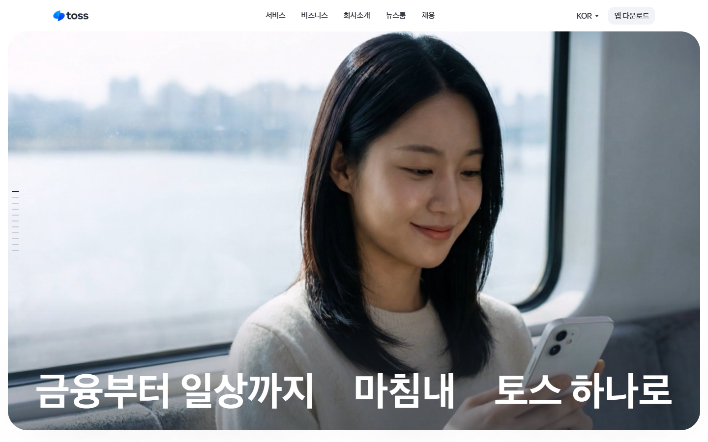
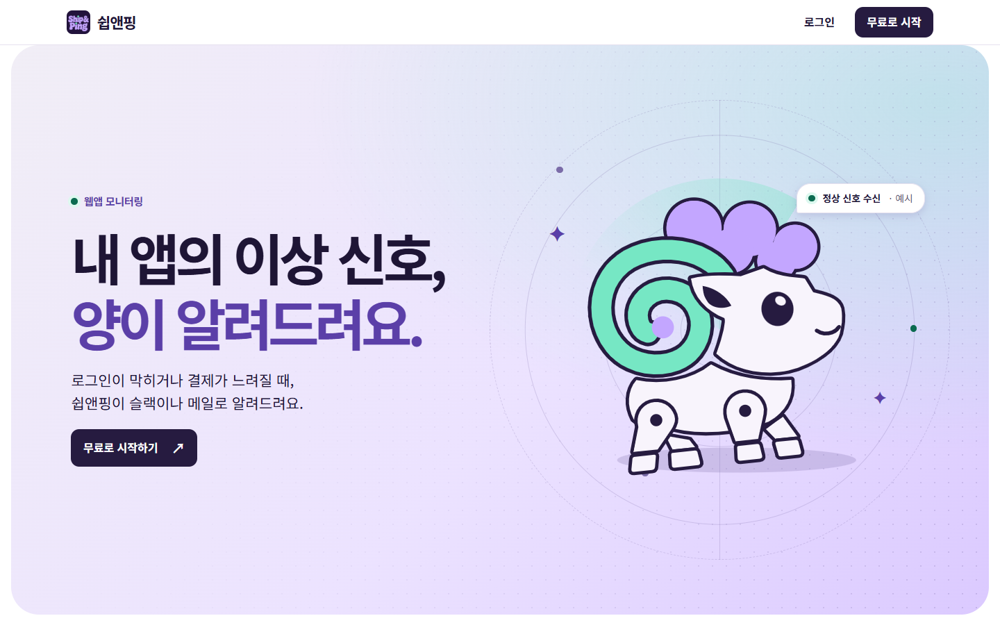
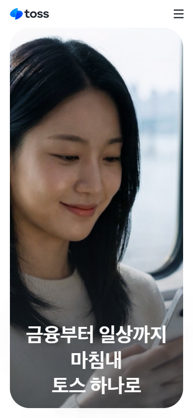
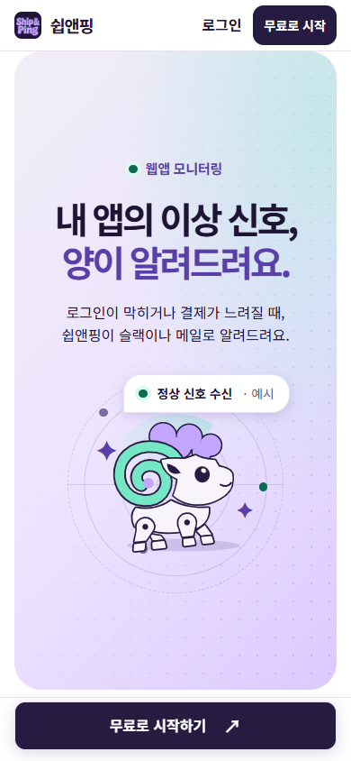
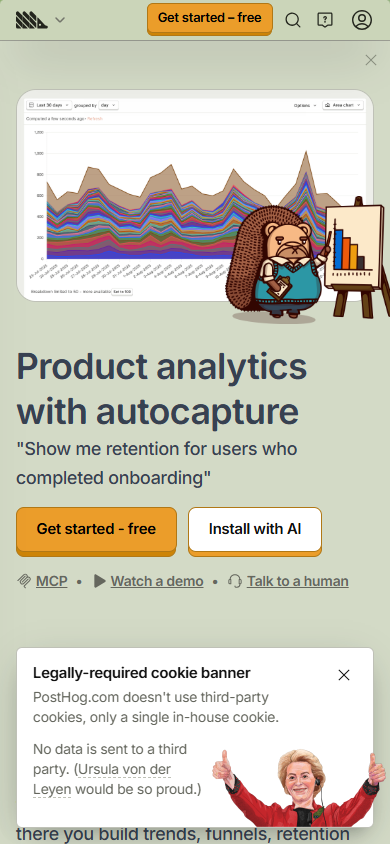
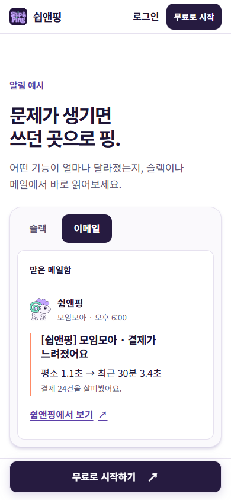
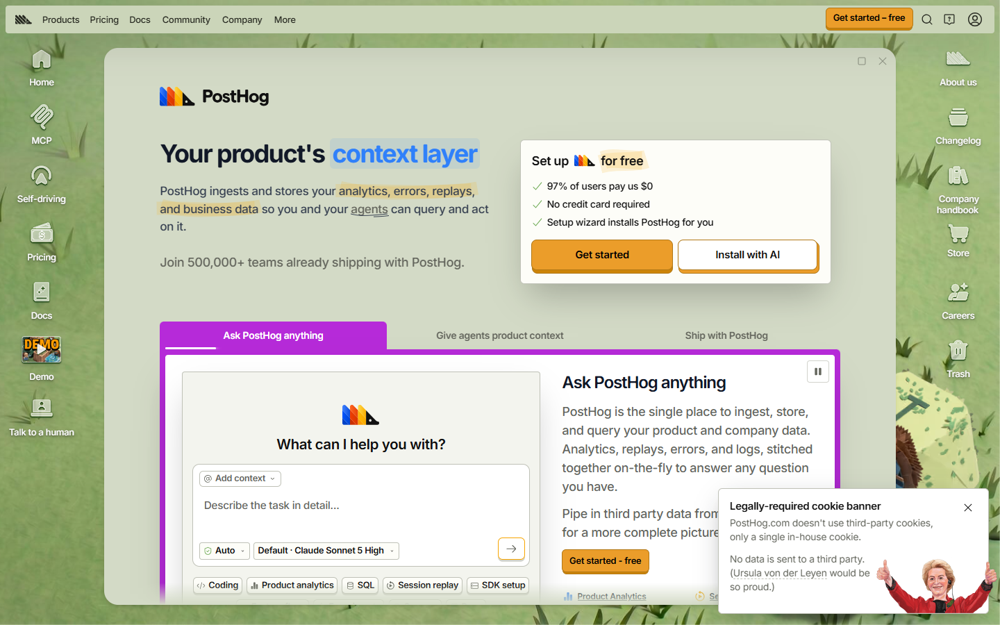
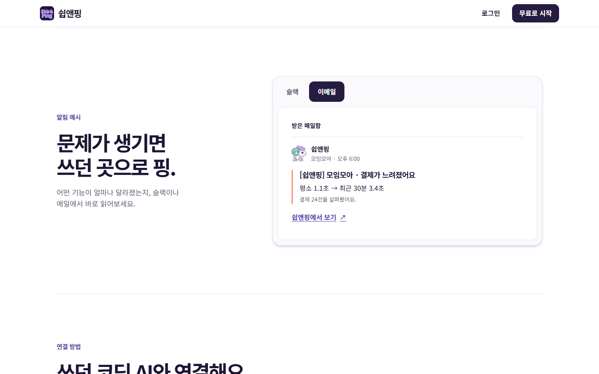

# 소개 페이지 리뉴얼 비교

같은 Windows Edge에서 1440×900과 390×844로 촬영했다. 토스의 큰 제목과 화면 바깥 여백, PostHog의 캐릭터와 제품 정보 배치를 비교했다. [원본 실측표](../../dashboard-2026-11-27/README.md)

| 레퍼런스 | 쉽앤핑 |
|---|---|
|  |  |
|  |  |
|  |  |
|  |  |

| 너비와 테마 | 변경 전 | 변경 후 |
|---|---|---|
| 1440 밝게 | [기존](before-1440-light.png) | [리뉴얼](after-1440-light.png) |
| 1440 어둡게 | [기존](before-1440-dark.png) | [리뉴얼](after-1440-dark.png) |
| 390 밝게 | [기존](before-390-light.png) | [리뉴얼](after-390-light.png) |
| 390 어둡게 | [기존](before-390-dark.png) | [리뉴얼](after-390-dark.png) |

PC에서는 토스의 16px 바깥 여백, 40px 모서리, 80px 제목에 맞춰 한 장면을 구성했다. 390px에서는 제목을 40px로 줄이고, 시작 버튼 자리를 하단에 확보했다. PostHog에서 참고한 20px 모서리의 제품 창은 채널 선택과 메시지 본문을 구분한다. 양과 신호 그림은 쉽앤핑 자산과 색상 토큰을 사용한다.

첫 비교에서 휴대폰 상태 말풍선이 양 머리와 겹쳤다. 말풍선을 그림 위로 올리고 하단 버튼 뒤에는 전용 바탕을 두었다. 어두운 테마에서 설명 문장의 색을 기본 본문색으로 조정했다.

Windows에서 웹 테스트 2,851개, 빌드와 린트를 통과했다. [브라우저 검사](capture.mjs)는 네 조건에서 고정 메뉴·휴대폰 CTA·탭 방향키·FAQ Enter·마키 일시정지·모션 감소·가로 넘침을 확인한다. axe의 WCAG 2 A·AA 및 2.1 A·AA 자동 검사 결과는 네 조건 모두 0건이었다. 키보드로 탭을 옮겼을 때 초점을 이전 탭에 남기는 변형은 테스트에서 검출했고, 복원한 뒤 다시 통과했다.
